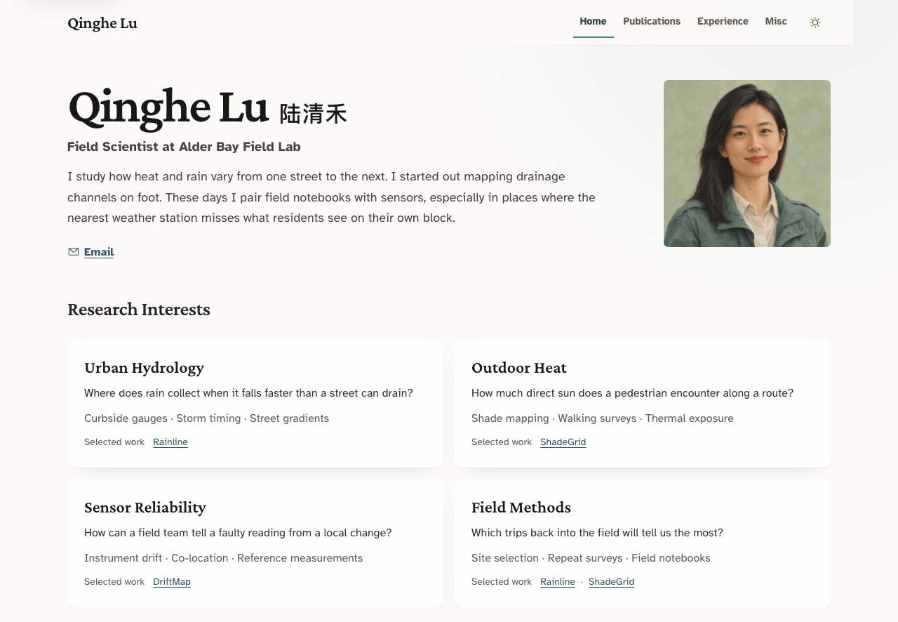
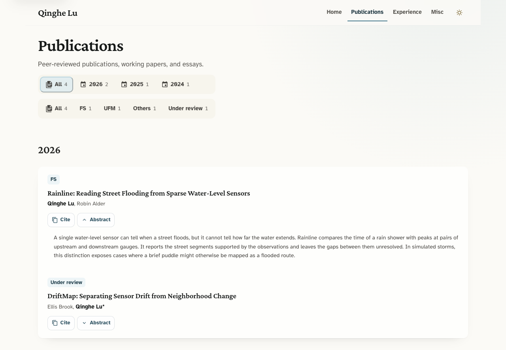
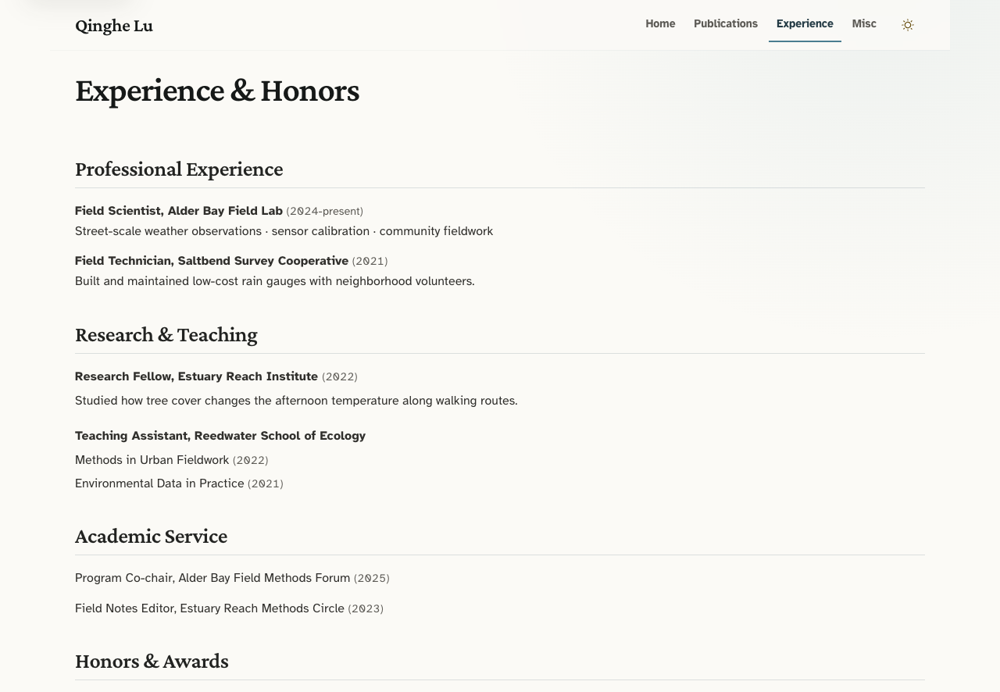
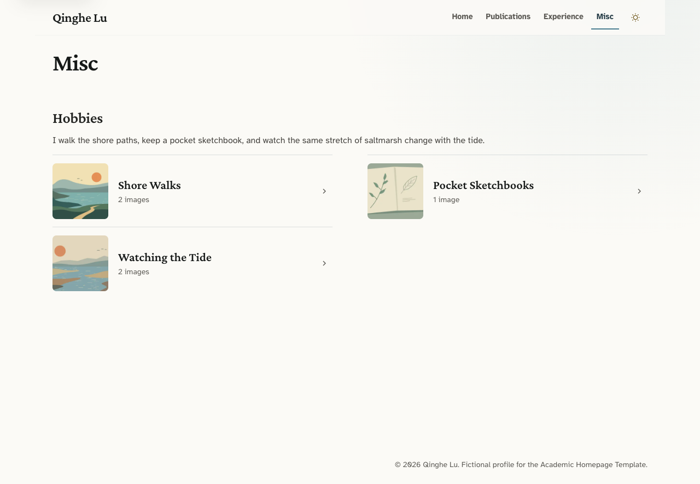

# Academic Homepage Template

**[中文 README](README.zh-CN.md)** · [Live demo](https://tianyaooooo.github.io/academic-homepage-template/) · [Use this template](https://github.com/tianyaooooo/academic-homepage-template/generate)

An Astro portfolio for researchers who want to feature a few papers on the homepage and keep a browsable bibliography alongside it. The demo follows Qinghe Lu (陆清禾), a fictional urban field scientist. Its people, institutions, publications, and results are fictional. The profile portrait is AI-generated, and the paper figures and album illustrations were made for this template.

## Page previews

Click a screenshot to enlarge it, or a page name to open the live demo.

<table>
  <tr>
    <td width="50%" valign="top">
      <a href="https://tianyaooooo.github.io/academic-homepage-template/"><strong>Home</strong></a><br>
      <a href="docs/preview.png"></a><br>
      Profile, research interests, selected papers, and a collapsible news timeline.
    </td>
    <td width="50%" valign="top">
      <a href="https://tianyaooooo.github.io/academic-homepage-template/publications/"><strong>Publications</strong></a><br>
      <a href="docs/publications.png"></a><br>
      Filter by year or venue, expand an abstract, or copy a BibTeX citation.
    </td>
  </tr>
  <tr>
    <td width="50%" valign="top">
      <a href="https://tianyaooooo.github.io/academic-homepage-template/cv/"><strong>Experience</strong></a><br>
      <a href="docs/experience.png"></a><br>
      Appointments, teaching, academic service, and honors.
    </td>
    <td width="50%" valign="top">
      <a href="https://tianyaooooo.github.io/academic-homepage-template/misc/"><strong>Misc</strong></a><br>
      <a href="docs/misc.png"></a><br>
      Browse illustrated albums by theme.
    </td>
  </tr>
</table>

## Start locally

Choose **Use this template → Create a new repository** and clone your copy. In its root, run the following with Node.js 24 and pnpm 11.

```sh
pnpm install --frozen-lockfile
pnpm dev
```

Open [localhost:4321](http://localhost:4321). Start with your name, position, portrait, and two or three representative papers.

## Make it yours

| Content | File |
| --- | --- |
| Name, position, optional second name, navigation, demo footer | [site.config.ts](site.config.ts) |
| Portrait and browser icon | [src/assets/portraits/profile.png](src/assets/portraits/profile.png) and [public/favicon.svg](public/favicon.svg) |
| Bio, contact details, news, featured paper summaries | [home.ts](src/data/home.ts) |
| Research interest cards and paper links | [about.yml](src/data/about.yml) |
| Papers, abstracts, corresponding authors | [publications.bib](src/data/publications.bib) |
| Venue filter labels and workshop aliases | [publication-venues.ts](src/data/publication-venues.ts) |
| Optional citation overrides and featured paper illustrations | [citations.bib](src/data/citations.bib) and [selected-publication-figures.ts](src/data/selected-publication-figures.ts) |
| Appointments, teaching, service, honors | [experience.ts](src/data/experience.ts) and [honors.ts](src/data/honors.ts) |
| Themed albums, captions, cover images | [hobby-albums.ts](src/data/hobby-albums.ts) |

A BibTeX entry key doubles as a link target. For example, the sample key `rainline` produces `/publications/#rainline`. Reference this key in a research interest or featured paper to reuse its title and link. A selected paper can have a summary with or without a figure.

## Publish on GitHub Pages

From your clone, with Git push access to your own repository and Python 3.9+ installed, run:

```sh
pnpm run deploy:pages
```

The command reads your GitHub `origin`, builds for its Pages address, and publishes the generated files to the `gh-pages` branch. In **Settings → Pages**, choose **Deploy from a branch → gh-pages → / (root)** and save. Keep editing source on `main`. Run the same command after changes. For a custom domain, set `SITE_URL` to its full HTTPS address and configure the domain in your own Pages settings.

For another static host, set `SITE_URL` and run `pnpm run build:pages`. Upload the contents of `site-export/`, including the dotfiles. Run `pnpm verify` to test the code, check types, and build.

## Credits and license

Adapted from [Scholar Pages](https://github.com/jxpeng98/astro-theme-scholars) by Jiaxin Peng. The template code and original demo illustrations are released under the [MIT License](LICENSE). Font and icon licenses are included in [public/licenses](public/licenses).
