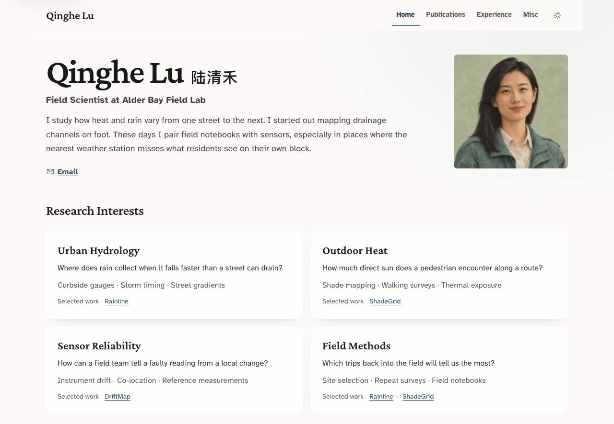
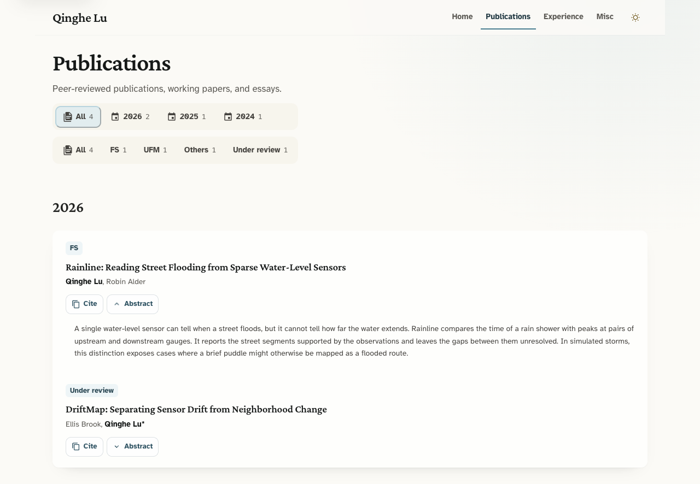
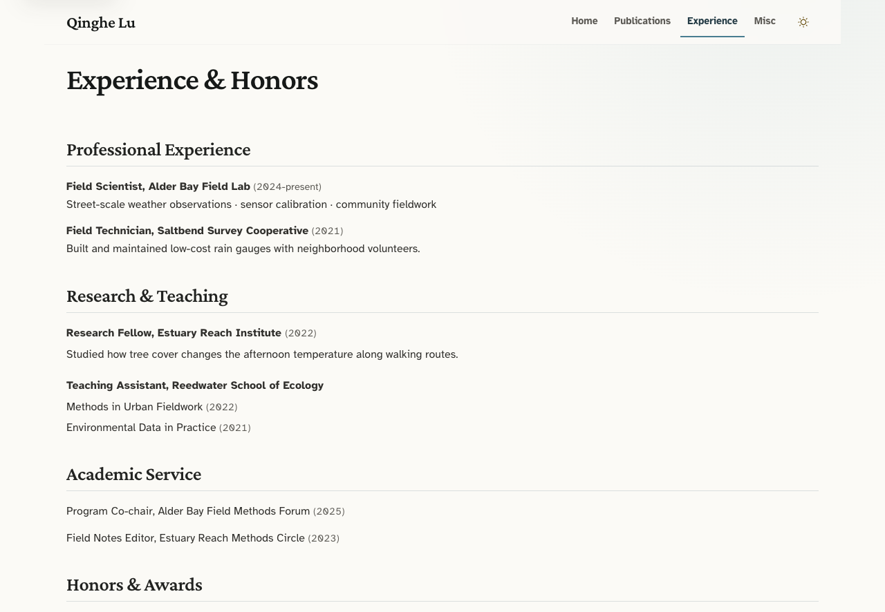
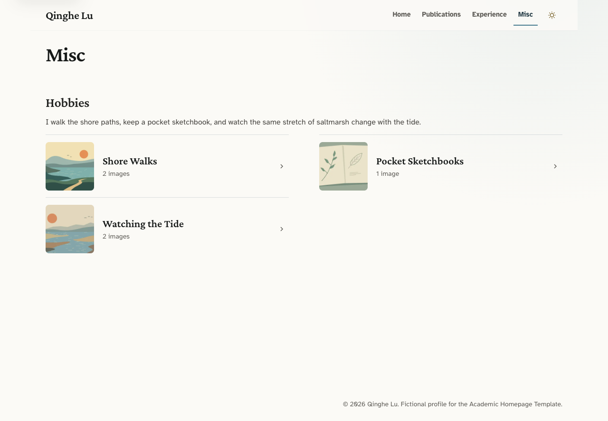

# 学术个人主页模板

**[English README](README.md)** · [在线演示](https://tianyaooooo.github.io/academic-homepage-template/) · [使用模板](https://github.com/tianyaooooo/academic-homepage-template/generate)

这套 Astro 模板适合想在首页讲清代表工作、同时保留完整论文列表的研究者。演示人物陆清禾（Qinghe Lu）是一位研究城市环境的虚构学者。人物、机构、论文和研究结果均为虚构，头像由 AI 生成，论文配图和相册插画为模板原创。

## 页面预览

点击截图可以放大，点击页面名称可以打开对应的在线演示。

<table>
  <tr>
    <td width="50%" valign="top">
      <a href="https://tianyaooooo.github.io/academic-homepage-template/"><strong>首页</strong></a><br>
      <a href="docs/preview.png"></a><br>
      研究兴趣、图文代表作和可展开的新闻时间线。
    </td>
    <td width="50%" valign="top">
      <a href="https://tianyaooooo.github.io/academic-homepage-template/publications/"><strong>论文</strong></a><br>
      <a href="docs/publications.png"></a><br>
      按年份或会议筛选，展开摘要或复制 BibTeX 引文。
    </td>
  </tr>
  <tr>
    <td width="50%" valign="top">
      <a href="https://tianyaooooo.github.io/academic-homepage-template/cv/"><strong>经历</strong></a><br>
      <a href="docs/experience.png"></a><br>
      集中展示工作履历、教学、学术服务和奖项。
    </td>
    <td width="50%" valign="top">
      <a href="https://tianyaooooo.github.io/academic-homepage-template/misc/"><strong>杂项</strong></a><br>
      <a href="docs/misc.png"></a><br>
      按主题浏览相册，点击封面查看同组图片。
    </td>
  </tr>
</table>

## 本地运行

点击 **Use this template → Create a new repository**，再把新仓库克隆到本地。安装 Node.js 24 和 pnpm 11，在仓库根目录运行：

```sh
pnpm install --frozen-lockfile
pnpm dev
```

打开 [localhost:4321](http://localhost:4321) 查看。可以先替换姓名、职位、头像以及两三篇代表作。

## 内容维护

| 内容 | 编辑位置 |
| --- | --- |
| 姓名、职位、可选的第二种语言姓名、导航、页脚示例声明 | [site.config.ts](site.config.ts) |
| 头像和网站图标 | [profile.png](src/assets/portraits/profile.png)、[favicon.svg](public/favicon.svg) |
| 简介、联系信息、动态和代表作介绍 | [home.ts](src/data/home.ts) |
| 研究兴趣和对应论文 | [about.yml](src/data/about.yml) |
| 论文、摘要和通讯作者 | [publications.bib](src/data/publications.bib) |
| 会议分组及 workshop 别名 | [publication-venues.ts](src/data/publication-venues.ts) |
| 正式引文和代表作配图 | [citations.bib](src/data/citations.bib)、[selected-publication-figures.ts](src/data/selected-publication-figures.ts) |
| 经历、教学、服务和奖项 | [experience.ts](src/data/experience.ts)、[honors.ts](src/data/honors.ts) |
| 相册、封面与图片说明 | [hobby-albums.ts](src/data/hobby-albums.ts) |

每篇论文的 BibTeX 键也是条目锚点。例如，`rainline` 对应 `/publications/#rainline`。首页精选论文按这个键读取论文信息，配图可选。

## 发布到 GitHub Pages

本机需安装 Python 3.9 或更高版本，并具备新仓库的 Git 推送权限。在自己的克隆目录运行：

```sh
pnpm run deploy:pages
```

命令从 Git 的 `origin` 识别你自己的 Pages 网址，构建站点，并把静态文件推送到 `gh-pages` 分支。首次发布后，打开仓库的 **Settings → Pages**，选择 **Deploy from a branch → gh-pages → / (root)** 并保存。平时在 `main` 修改源码，更新演示时再次运行上述命令。

使用自定义域名时，将 `SITE_URL` 设为完整的 HTTPS 网址，并在自己的 Pages 设置中绑定域名。使用其他静态托管服务时，设置 `SITE_URL`，运行 `pnpm run build:pages`，上传 `site-export/` 中的所有文件。运行 `pnpm verify` 可以检查测试、类型和构建结果。

## 来源与许可

本模板基于 Jiaxin Peng 的 [Scholar Pages](https://github.com/jxpeng98/astro-theme-scholars) 改造。代码和原创示例插画采用 [MIT 许可证](LICENSE)。字体与图标各自的许可证保存在 [public/licenses](public/licenses)。
